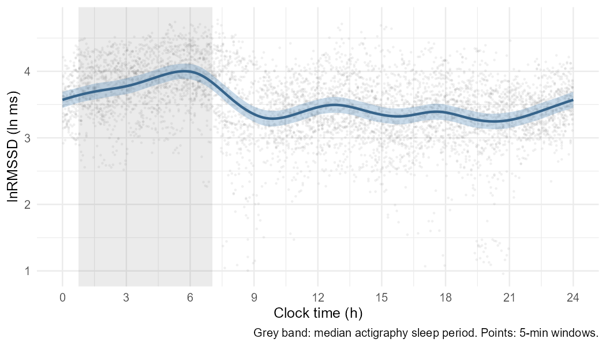
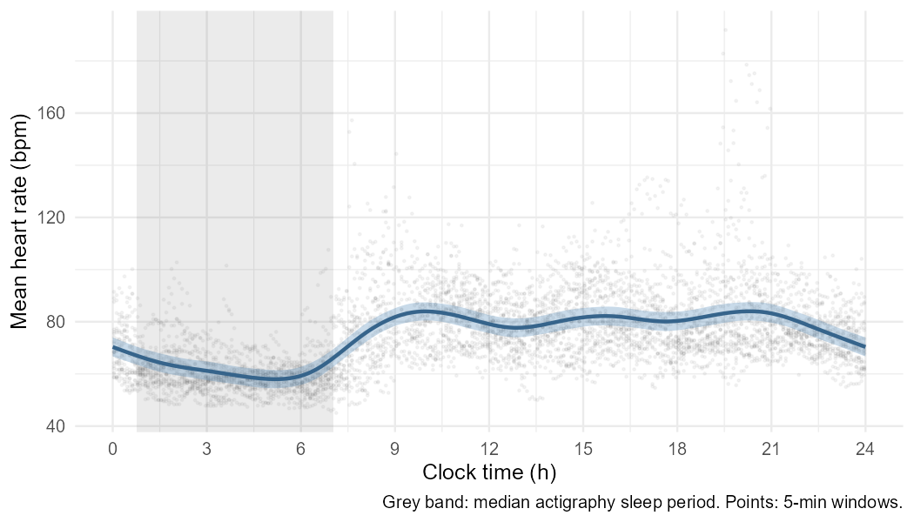
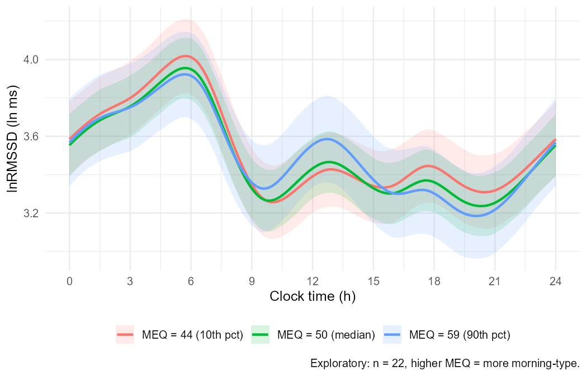
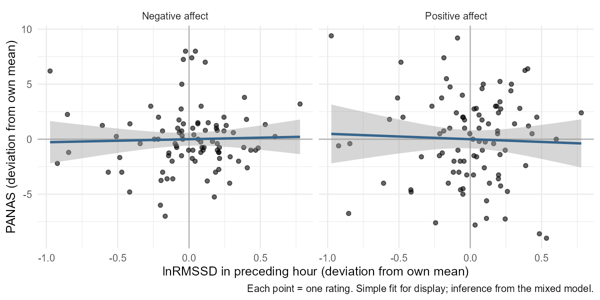

```{r setup}
suppressPackageStartupMessages({
  library(tidyverse)
  library(mgcv)
  library(knitr)
})
root <- here::here()
tab <- \(f) read_csv(file.path(root, "output", "tables", f), show_col_types = FALSE)
fig <- \(f) file.path(root, "output", "figures", f)
f1 <- \(x) formatC(x, format = "f", digits = 1)
f2 <- \(x) formatC(x, format = "f", digits = 2)
fp <- \(p) if (p < 0.001) "< 0.001" else paste("=", formatC(p, format = "f", digits = 3))

art <- tab("artefact_summary.csv")
wq  <- tab("window_quality.csv")
sw  <- tab("sleep_wake_hrv.csv")
gm  <- readRDS(file.path(root, "derived", "gamm_models.rds"))
pm  <- readRDS(file.path(root, "derived", "panas_models.rds"))
```

::: {.callout-note}
This is an **independent analysis of a public dataset**. I did not collect
these data. All analyses are **exploratory and non-causal**.
:::

# Question

How does heart rate variability (HRV) change over 24 hours of everyday life,
how different is it during sleep and wakefulness, and does it relate to
chronotype or to momentary affect? The analysis follows a standard
time-domain HRV pipeline [@laborde2017; @shaffer2017]. The 24-h profile is
modelled with a generalised additive mixed model (GAMM) and a chronotype
interaction, the model family that @balter2024 used for diurnal variation in
self-reported psychiatric symptoms (they did not study HRV).

# Data

MMASH v1.0.0 [@rossi2020; @mmash] contains 24 h of beat-to-beat intervals
from a Polar H7 chest strap, actigraphy-estimated sleep, and questionnaires
for 22 healthy young adult men. The questionnaires cover chronotype (MEQ) and
positive and negative affect (PANAS) at five time points. The raw data are
not redistributed here.

# Methods

**1. Artefact handling (Python).** Inter-beat intervals (IBIs) outside
0.3–2.0 s (200–30 bpm) were removed. Each remaining beat was compared with the
median of the 11 surrounding in-range beats and removed if it deviated by more
than 20 % (a local-median variant of the Malik 20 % successive-difference
rule). Successive differences were used only between two valid beats that were
adjacent in the original series, with no recording gap > 3 s in between.

**2. 5-min windows.** In clock-aligned 5-min windows I computed mean HR, SDNN,
RMSSD and lnRMSSD. A window was *usable* if valid IBIs covered ≥ 60 % of it
(≥ 180 s), ≤ 20 % of its beats were removed, and it had ≥ 100 valid successive
differences. The 60 % threshold reflects a property of the data: in every
recording, about 8 s of beats are missing roughly every 33 s, so no window
exceeds ~78 % coverage.

**3. Sleep vs wake.** Windows lying entirely between actigraphy sleep onset
and getting up were labelled *sleep*. Windows lying entirely outside the night
(first bedtime to last get-up) were labelled *wake*. Windows that overlapped
the night but were not fully asleep were excluded. For each participant I took
the median of each metric by state and compared the two states with paired
Wilcoxon signed-rank tests.

**4. 24-h profile (R, mgcv).** lnRMSSD and mean HR were modelled with
`bam()`. Each model has a cyclic cubic smooth of clock time (k = 16), a random
intercept per participant, and an AR(1) error for consecutive windows
(ρ = `r f2(gm$rho)`). A sensitivity model replaced the random intercept with
participant-specific cyclic smooths (factor-smooth interaction). The
exploratory chronotype model added `s(MEQ)` and a `ti(clock, MEQ)`
interaction, alongside participant-specific smooths.

**5. HRV and affect.** For each PANAS rating, I averaged lnRMSSD over the
usable windows in the preceding 60 min (at least 6 windows required).
lnRMSSD was split into a within-person part (deviation from the person's own
mean) and a between-person part (the person's mean). Linear mixed models
included the time point as a fixed effect and a random intercept per
participant.

# Results

## Data quality

```{r}
pr <- art$pct_removed_total
```

Across participants, a median of `r f1(median(pr))` % of beats were removed
(range `r f1(min(pr))`–`r f1(max(pr))` %). User 4 was an outlier
(`r f1(art$pct_removed_total[art$user == 4])` %): many of their IBIs were
about twice the normal length, which indicates R-peaks missed by the strap.
Of `r sum(wq$n_windows)` windows, `r sum(wq$n_usable)`
(`r f1(100 * sum(wq$n_usable) / sum(wq$n_windows))` %) were usable; for user 4,
only `r f1(wq$pct_usable[wq$user == 4])` % were usable.

```{r}
#| label: tbl-quality
#| tbl-cap: "Artefact removal and usable 5-min windows per participant."
art |>
  left_join(wq, by = "user") |>
  select(User = user, `Hours` = record_hours, `% out of range` = pct_out_of_range,
         `% local-median rule` = pct_succ_diff, `% removed` = pct_removed_total,
         `Windows` = n_windows, `% usable` = pct_usable) |>
  kable()
```

## Sleep vs wake

```{r}
w_ln <- wilcox.test(sw$ln_rmssd_sleep, sw$ln_rmssd_wake, paired = TRUE, exact = FALSE)
w_hr <- wilcox.test(sw$mean_hr_sleep, sw$mean_hr_wake, paired = TRUE, exact = FALSE)
```

For the `r nrow(sw)` participants with sleep data, lnRMSSD was higher during
sleep than during wakefulness in `r sum(sw$diff_ln_rmssd > 0)` of
`r nrow(sw)` (median difference `r f2(median(sw$diff_ln_rmssd))` ln ms;
Wilcoxon p `r fp(w_ln$p.value)`). Heart rate was lower during sleep in
`r sum(sw$diff_mean_hr < 0)` of `r nrow(sw)` (median difference
`r f1(median(sw$diff_mean_hr))` bpm; p `r fp(w_hr$p.value)`).

```{r}
#| label: fig-sleepwake
#| fig-cap: "Per-participant median lnRMSSD during wakefulness and sleep."
#| fig-height: 3.5
sw |>
  select(user, Wake = ln_rmssd_wake, Sleep = ln_rmssd_sleep) |>
  pivot_longer(-user, names_to = "state", values_to = "ln_rmssd") |>
  mutate(state = factor(state, c("Wake", "Sleep"))) |>
  ggplot(aes(state, ln_rmssd, group = user)) +
  geom_line(colour = "grey60") + geom_point(colour = "steelblue4") +
  labs(x = NULL, y = "Median lnRMSSD (ln ms)") +
  theme_minimal(base_size = 12)
```

## 24-h profile

```{r}
s_r <- summary(gm$rmssd)
s_m <- summary(gm$meq)$s.table
```

The clock-time smooth explained substantial variation in lnRMSSD
(edf = `r f1(s_r$s.table["s(clock)", "edf"])`; adjusted R² including
participant effects = `r f2(s_r$r.sq)`). lnRMSSD rose through the night,
peaked in the early morning, dropped steeply around getting up, and stayed
low and fairly flat during the day before rising again in the late evening
(@fig-gamm). Heart rate showed the mirror image. Allowing each participant
their own curve improved fit (AIC `r round(AIC(gm$fs))` vs
`r round(AIC(gm$rmssd))`).

{#fig-gamm}

{#fig-hr}

**Chronotype (exploratory).** The clock × MEQ interaction had a nominal
p `r fp(s_m["ti(clock,MEQ)", "p-value"])` (edf
`r f1(s_m["ti(clock,MEQ)", "edf"])`). However, MEQ varies only between the 22
participants, the MEQ range was narrow (few clear morning types), and the
predicted curves overlap almost entirely (@fig-meq). An earlier
random-intercept-only version gave a far smaller p-value, which shows how
sensitive this test is to the random-effect structure. I do not interpret it
as evidence of a chronotype effect.

{#fig-meq}

## HRV before PANAS ratings

```{r}
pt <- summary(pm$pos)$p.table
nt <- summary(pm$neg)$p.table
```

Using `r nrow(pm$data)` ratings from `r n_distinct(pm$data$user)`
participants, within-person deviations in lnRMSSD in the preceding hour were
not associated with positive affect (b = `r f2(pt["hrv_within", 1])`, p
`r fp(pt["hrv_within", 4])`) or negative affect
(b = `r f2(nt["hrv_within", 1])`, p `r fp(nt["hrv_within", 4])`). With at most
five ratings per person, the design has little power. This is an
inconclusive null result, not evidence of no coupling.

{#fig-panas}

# Limitations

n = 22, men only, aged 20–40 (age missing for one), one 24-h recording each. Clock time is
not circadian phase: there is no DLMO or core body temperature, and the
profile mixes endogenous rhythm with behaviour (sleep, posture, activity,
meals). Sleep periods are estimated from actigraphy, not polysomnography, so
sleep stages are unknown. IBIs are device-derived by the Polar H7, not
measured from raw ECG, and about a quarter of each recording is missing in
regular gaps. Wake windows include physical activity, which was not modelled.
GAMM p-values are approximate, and between-person effects rest on 22 people.
All analyses are exploratory and do not support causal claims.

# References {.unnumbered}

::: {#refs}
:::
